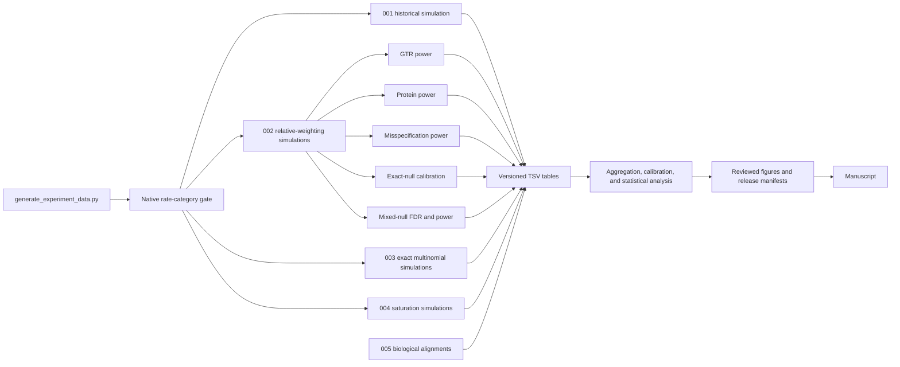

# Simulation and Data-Analysis Map

This is the source map for every active SatuTe simulation and downstream
data-analysis path. A simulation creates synthetic alignments or synthetic
count data. Bootstrap resampling, aggregation, plotting, and analysis of
biological alignments are listed separately because they do not create a new
generative experiment.

Use the main interface to display the current map or execution plan:

```bash
python generate_experiment_data.py --map
python generate_experiment_data.py --profile full --plan
python generate_experiment_data.py --figures --plan
```

## End-to-end lineage



## Generative simulations

| Map ID | Owner | Generator and backend | Design | Primary outputs |
|---|---|---|---|---|
| `SIM-001` | `001/historical_power_reconstruction` | `experiments/001_paper_reconstruction/run.py`; IQ-TREE AliSim | Historical JC Fig. 2 tree, site, branch, and replicate grid | `fig2_reconstruction_detail.tsv`, `fig2_reconstruction_summary.tsv` |
| `SIM-002A` | `002/gtr_power` | `experiments/002_relative_weighting/run.py`; AliSim by manifest, with Seq-Gen and INDELible adapters retained | Matched fixed GTR, GTR+G4, and GTR+I+G4 | Head-to-head detail, normalized summary, branch/FDR audits, timing |
| `SIM-002B` | `002/protein_power` | Same driver; AliSim | Matched fixed LG/WAG/JTT/Q.PFAM+G4 | Same head-to-head tables |
| `SIM-002C` | `002/misspecification_power` | Same driver; AliSim | GTR data evaluated under GTR, JC, K2P, and F81 | Same head-to-head tables |
| `SIM-002D` | `002/fdr_exact_null` | `experiments/002_relative_weighting/fdr_calibration_run.py`; exact independent-component simulator plus native IQ-TREE analysis | 5,000 replicates per cell, split into threshold training and held-out nulls | `truth_branch_audit.tsv`, `replicate_fdp.tsv`, `calibration_summary.tsv`, `timing.tsv` |
| `SIM-002E` | `002/fdr_mixed_null` | Same calibration driver | Prespecified 50:50 null/finite-alternative mixture, 2,000 replicates per cell | Same truth-labelled calibration tables |
| `SIM-003` | `003/invariant_mixture_power` | `experiments/003_invariant_mixture/run.py`; NumPy multinomial draws from exact pattern probabilities | Paired null and alternative alignments for `+I+G4` and `+I+R4` | `weighted_invariant_summary.tsv`, `weighted_invariant_paired.tsv`, assumptions |
| `SIM-004` | `004/saturation_diagnostics` | `experiments/004_saturation_diagnostics/run.py`; IQ-TREE AliSim | Native formula behavior and long-branch null calibration | Diagnostic detail/summary, category tables, thresholds, model curve |

`experiments/002_relative_weighting/run.py` owns the only genuine simulator
adapter seam: AliSim, Seq-Gen, and INDELible all create an alignment satisfying
the same driver contract. Cluster shell and Slurm files submit or shard these
designs; they do not define additional simulations.

## Synthetic validation and resampling

| Map ID | Purpose | Entry point | Classification |
|---|---|---|---|
| `VAL-RATE` | Validate IQ-TREE category assignments, rates, effective lengths, category rows, and pooling for `+G4`, `+R4`, `+I+G4`, and `+I+R4` | `tests/native/test_satute_rate_categories.py` | AliSim correctness fixture; mandatory preflight |
| `VAL-SMOKE` | Native JC/GTR command and output smoke checks | `tests/native/test_satute_simulated.sh` | AliSim correctness fixture |
| `VAL-FORMULA` | Compare both native formulas with an independent Python implementation | `tests/native/compare_formulas.py` | AliSim correctness fixture |
| `VAL-GENERAL` | Check the independent reference on a larger tree | `tests/native/test_satute_reference_general.py` | AliSim correctness fixture |
| `VAL-NULL` | Verify the exact saturation-null distribution | `tests/exact/test_saturation_null.py` | NumPy multinomial statistical validation |
| `RESAMPLE-PAIR` | Paired confidence intervals for formula differences | `src/satute_analysis/statistics.py` | Bootstrap resampling only; not a generative simulation |

`tests/native/run_satute_phase1_checks.sh` is the bundle adapter for the four
native validation fixtures. Unit tests that mock a simulator or verify command
construction are interface tests and do not generate scientific evidence.

## Data analyses

| Owner | Analysis stages | Entry points |
|---|---|---|
| `001` | Aggregate replicate detail into historical power curves; render reconstructed Fig. 2 evidence | `experiments/001_paper_reconstruction/run.py::aggregate`, `experiments/001_paper_reconstruction/render.py` |
| `002` publication power | Validate/merge shards, aggregate decision-rule summaries, profile completeness and timing, render formula-specific and paired power comparisons | `experiments/002_relative_weighting/combine.py`, `experiments/002_relative_weighting/profile.py`, `src/satute_analysis/benchmark_summary.py`, `experiments/002_relative_weighting/render.py`, `experiments/002_relative_weighting/render_power_summary.py`, `experiments/002_relative_weighting/render_formula_comparison.R` |
| `002` FDR calibration | Stream truth-labelled shards, validate family accounting, train/hold out calibration, calculate FDP/FDR/power, render formula and paired differences | `experiments/002_relative_weighting/fdr_calibration_postprocess.py`, `experiments/002_relative_weighting/recalibrate_heldout_from_truth.py`, `src/satute_analysis/fdr_calibration.py`, `experiments/002_relative_weighting/render_fdr_calibration.R` |
| `003` | Calculate nominal and calibrated type-I error/power, paired power shifts, confidence intervals, and assumption checks | `experiments/003_invariant_mixture/run.py`, `experiments/003_invariant_mixture/render_full.py`, `experiments/003_invariant_mixture/render_shift.py` |
| `004` | Summarize native diagnostic trajectories, rate categories, calibrated thresholds, normalization, and theoretical saturation curves | `experiments/004_saturation_diagnostics/run.py`, `experiments/004_saturation_diagnostics/summarize_null.py` |
| `005` biological | Prepare codon-preserving HCV inputs, run IQ-TREE/SatuTe on supplied alignments, summarize branches/windows, and render curated/independent/HCV figures | `experiments/005_biological_windows/prepare_hcv_example.py`, `experiments/005_biological_windows/analyze_dataset.py`, `experiments/005_biological_windows/render_curated.py`, `experiments/005_biological_windows/render_independent.py`, `experiments/005_biological_windows/render_hcv_example.py` |
| Release/manuscript | Checksum promoted evidence; link each figure case to its summary and replicate-level tables; render and publish the complete colour-coded power atlas from one case map | `tools/maintenance/create_release_manifest.py`, `tools/maintenance/generate_publication_power_figures.py`, `tools/maintenance/audit_power_plots.py` |

Biological experiment 005 is deliberately absent from the simulation table:
it analyzes real, explicitly supplied alignments.

## Execution adapters

| Environment | Role | Entry points |
|---|---|---|
| Local | Complete sequential generation, selective reruns, smoke plans | `generate_experiment_data.py`, colocated `workflow.py` files |
| LiSC | Publication GTR/protein/misspecification arrays | `tools/cluster/lisc/submit_publication_suite.sh`, `submit_full_head_to_head.slurm`, `run_full_head_to_head_shard.sh` |
| LiSC | Exact-null and mixed-null calibration arrays/postprocessing | `submit_fdr_calibration_suite.sh`, `run_fdr_calibration_shard.sh`, `submit_fdr_postprocess_suite.sh`, `postprocess_fdr_calibration.slurm` |
| AWS | Earlier Seq-Gen shard execution and merge/plot adapter | `tools/cluster/aws/run_full_head_to_head_shard.sh`, `combine_verify_plot_full.sh` |

## Existing artifact lineage

The workspace contains reviewed evidence, raw parents, pilots, and smoke
outputs. Directory presence does not imply promotion.

| Canonical study | Reviewed or current evidence | Raw parents and earlier exploratory runs |
|---|---|---|
| `001/historical_power_reconstruction` | `artifacts/cluster/lisc/paper-fig2-jc-reps1000-v4-217bd244e77-20260715`, `artifacts/releases/legacy`; archived main and misspecification PDFs plus reconstruction-data links under `artifacts/publication/power/original-paper` | `paper-fig2-jc-reps1000` |
| `002/gtr_power` | `paper-matched-gtr-rate-invar-reps1000-ff7c9034b00-20260715-postprocessed-7b264fe9c5ef-v2` | Matching raw parent; `boundary250-corrected-dna-*`, `classical-ratehet-*`, `evidence-corrected-*`, `manuscript-ratehet-*`, `pilot-gtr-*`; local `gtr-boundary-*`, `skewed-gtr-*`, `plot-design-preview-*` |
| `002/protein_power` | `paper-matched-protein-g4-reps1000-ff7c9034b00-20260715-postprocessed-7b264fe9c5ef` | Matching raw parent; `boundary250-corrected-protein-*`; local `protein-lg-boundary-*` |
| `002/misspecification_power` | `paper-gtr-misspec-reps1000-ff7c9034b00-20260715-postprocessed-7b264fe9c5ef-v5` | Matching raw parent; `supp-misspec-gtr-pf06346-reps1000` |
| `002/fdr_exact_null`, `002/fdr_mixed_null` | `fdr-calibration-reps5000-2000-corrected-ties` | `fdr-calibration-reps5000-2000-7b264fe9c5ef`, exact/mixed postprocessed parents, corrected held-out table |
| `003/invariant_mixture_power` | `artifacts/releases/invariant-mixture-v1`, local `weighted-invariant-full` | `weighted-invariant-grid`, `weighted-invariant-shift`, `rerun-20260713` |
| `004/saturation_diagnostics` | Local `saturation-diagnostics` | Smoke/check outputs |
| `005/biological_windows` | `artifacts/releases/biological/enhanced_*`, `independent_*`, `hcv-codon-windows-20260717` | Explicit biological source/input files inside each release |
| Validation only | `artifacts/local/check` | `artifacts/local/smoke` |

The `logs` directory is empty in the current workspace. Pilot and raw-parent
directories remain useful for provenance but must not be cited as reviewed
evidence unless promoted through a checksummed release manifest.
