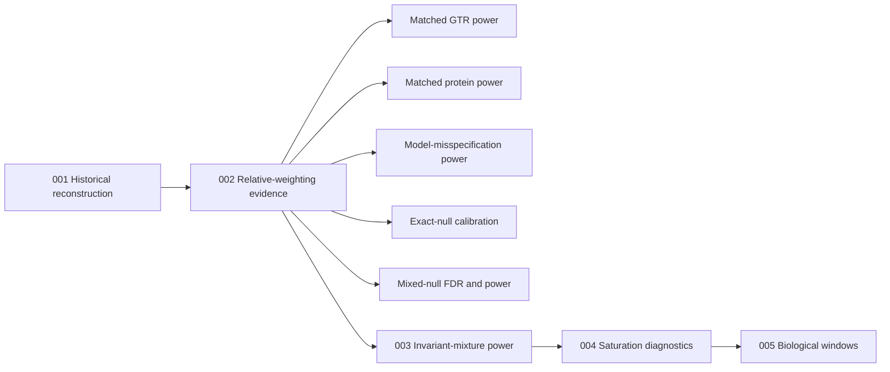

# Experiment Modules

Each numbered directory is one self-contained experiment module. Its owned
files follow the same small interface:

| File | Ownership |
|---|---|
| `experiment.json` | Identity, question, status, consumers, paths, and run configuration |
| `workflow.py` | Smoke/full orchestration for managed experiments |
| `run.py` or the declared driver | Scientific computation and its command-line interface |
| `render*.py` / `render*.R` | Figure or table rendering for that experiment |
| `README.md` | Scientific intent, evidence contract, and direct-use notes |

The directories are intentionally numbered because execution order and
historical dependency matter. They are discovered from their colocated
manifests; there is no second central registry to keep synchronized.

## Complete scientific picture

For the exhaustive generator, analysis, validation, execution-adapter, and
artifact-lineage inventory, see
[`docs/overview/simulation-analysis-map.md`](../docs/overview/simulation-analysis-map.md).



| Experiment/study | Primary outcome | Scale |
|---|---|---|
| `001/historical_power_reconstruction` | Published baseline reconstruction | Local |
| `002/gtr_power` | Matched GTR, GTR+G4, and GTR+I+G4 power | Cluster |
| `002/protein_power` | Matched LG/WAG/JTT/Q.PFAM+G4 power | Cluster |
| `002/misspecification_power` | Power under GTR→GTR/JC/K2P/F81 evaluation | Cluster |
| `002/fdr_exact_null` | Held-out exact-null calibration | Cluster |
| `002/fdr_mixed_null` | Empirical FDR and power under a 50:50 mixed null | Cluster |
| `003/invariant_mixture_power` | Calibrated boundary power and type-I error | Local |
| `004/saturation_diagnostics` | Statistic behavior across branch length | Local |
| `005/biological_windows` | Explicit-input biological application | Manual |

The power studies were not removed. They are named studies within experiments
002 and 003. Unit and exact tests verify their calculations; the full
replicate grids estimate statistical power. A smoke run verifies wiring only
and must not be reported as a power estimate.

Every managed run from `./satute data` starts with the native
rate-category correctness gate. It checks IQ-TREE-owned `+G4`, `+R4`,
`+I+G4`, and `+I+R4` assignments, category multipliers, effective branch
lengths, category-level statistics, pooled statistics, and the expected pure
`+I` rejection. This is a prerequisite for the rate-heterogeneous power
studies, not another power estimate. Use
`./satute check rate-categories` to run it alone.

Shared mathematics, schemas, artifact handling, and experiment discovery live
under `src/satute_analysis/`. Cluster and maintenance adapters live under
`tools/`; generated outputs never live beside experiment source.
Smoke outputs are isolated under
`artifacts/local/smoke/<experiment-id>/<study-id>/schema-<config-schema>` for
multi-study experiments, so an old result cannot be resumed under a newer
table contract.

Use the single workspace interface:

```bash
./satute data --profile smoke --plan
./satute data --profile smoke
./satute data --profile full
```

`--profile full` is the complete publication-scale plan and can be very
expensive. Use repeatable
`--only 002_relative_weighting/gtr_power` selections for targeted reruns.
Targeted execution and validation use subcommands of the same interface:

```bash
./satute experiment 002_relative_weighting --study protein_power --profile full
./satute check power
```

Experiment 005 declares `execution: manual`: it requires explicit biological
inputs and therefore documents direct driver commands instead of inventing
defaults.
